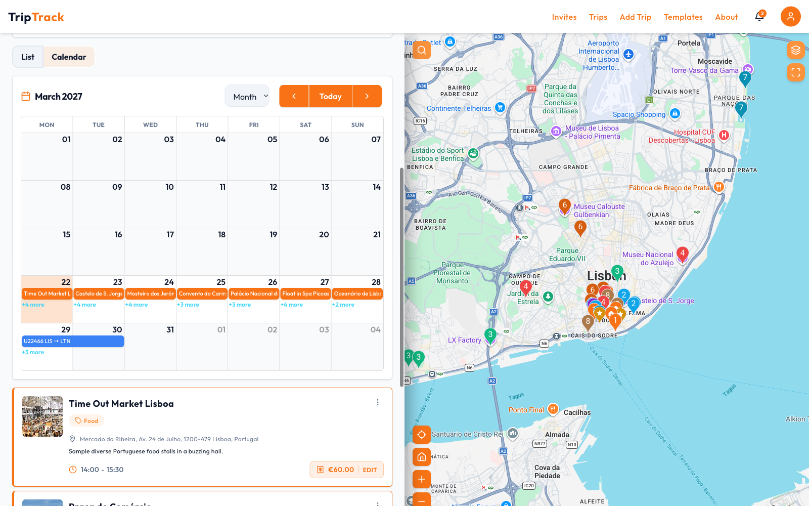
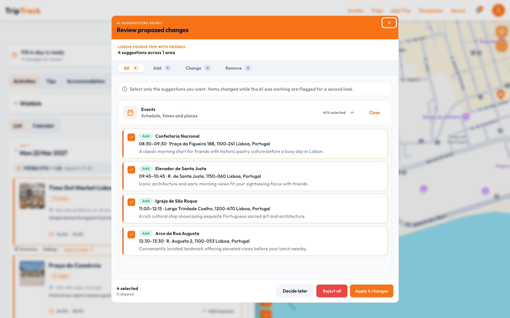
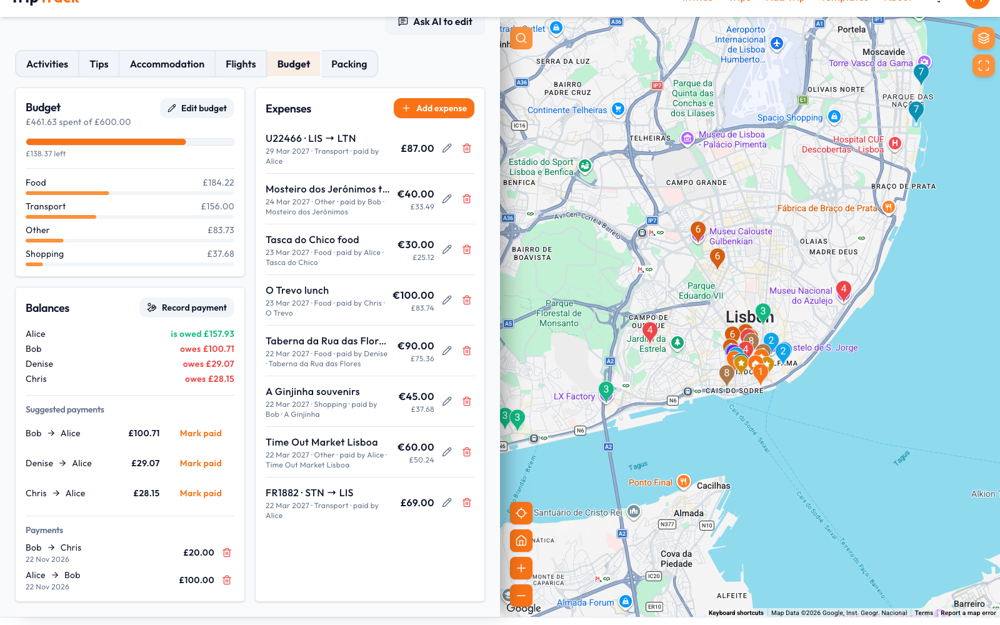
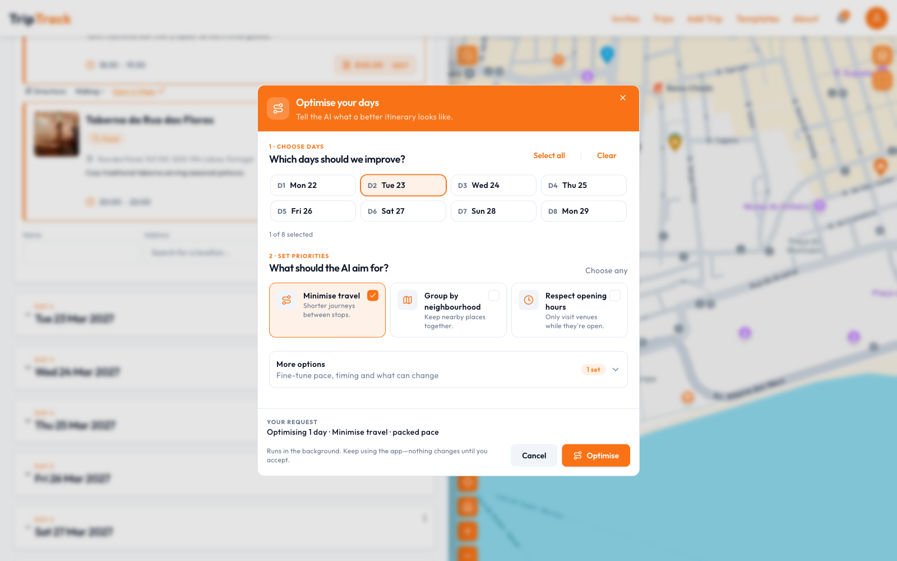
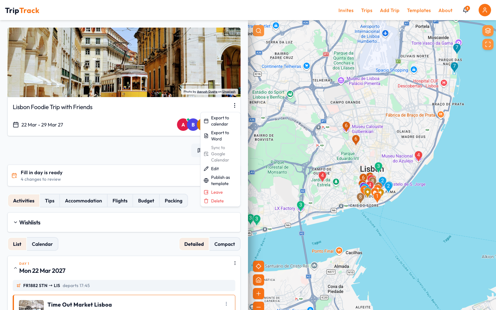
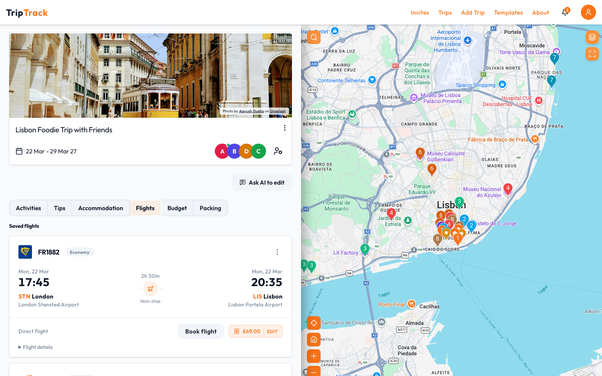
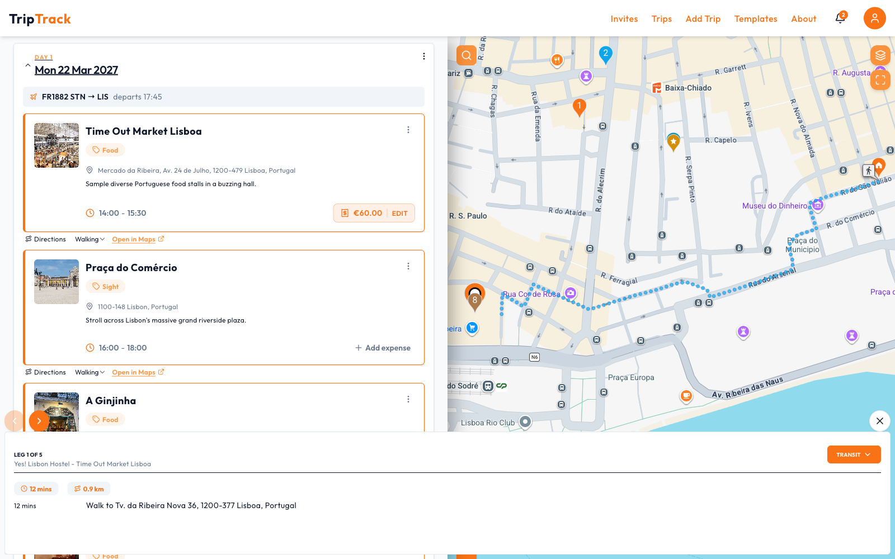
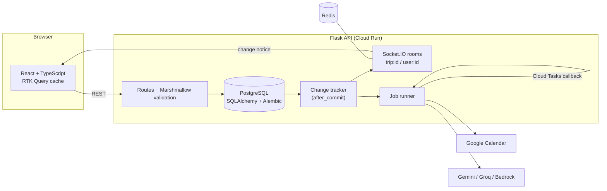

# TripTrack

A shared trip planner. A group builds one itinerary on a map and a calendar, everyone sees changes as soon as they are saved, and AI can draft or change the plan but never applies anything until a person approves it.

**[Live demo](https://app.triptrack.uk/demo)** · [CI workflow](.github/workflows/ci.yml)



<table>
  <tr>
    <td><br><sub>AI suggestions wait for approval</sub></td>
    <td><br><sub>Budget and settling up</sub></td>
  </tr>
  <tr>
    <td><br><sub>Day optimiser</sub></td>
    <td><br><sub>Google Calendar sync</sub></td>
  </tr>
  <tr>
    <td><br><sub>Saved flights</sub></td>
    <td><br><sub>Routes between events</sub></td>
  </tr>
</table>

## What it does

* **AI trips with approval:** describe a trip in one sentence, or ask for a change such as moving a dinner. The result is a suggestion to review, not a saved change.
* **Realtime collaboration:** everyone viewing a trip sees changes as soon as they are saved, on every device.
* **Google Calendar sync:** changes flow both ways between a trip and each person's Google Calendar.
* **Map and calendar view:** the schedule, routes and place details on one screen.
* **Budget and expenses:** track spending and split costs across the group.
* **Roles:** admins can edit, viewers can only follow the plan.

Flights, trip templates, Google event search and calendar or Word export sit alongside these. The in-app About page lists everything.

## Architecture



* **Frontend:** React, TypeScript and Vite. Server data lives in one RTK Query cache that is refreshed when the server announces a change. Redux slices hold only interface and sign-in state. Google Maps draws the map, routes and place details.
* **Backend:** Flask with the application factory pattern, about 100 routes across 20 blueprints. Marshmallow validates requests. SQLAlchemy and Alembic manage 24 tables on PostgreSQL.
* **Realtime:** Socket.IO rooms per trip and per user. Redis is used as the message queue when configured, so several instances share one socket layer.
* **Background work:** Google Cloud Tasks runs calendar syncing and AI generation outside the request. Gemini, Groq and AWS Bedrock sit behind adapters with automatic fallback. Web push tells users when a job has finished.
* **Delivery:** Docker, GitHub Actions and Google Cloud Run.

## Key decisions

| Decision | Why | Cost | Code |
| :--- | :--- | :--- | :--- |
| One save hook powers live updates and calendar sync | No sync code per feature. A listener on the database save step notes what changed and announces it only after the commit succeeds. | Automatic behaviour is harder to trace, and every new table must be registered with a rule for who to notify. | [`change_tracker.py`](event-planner-app-backend/src/realtime/change_tracker.py), [`change_listener.py`](event-planner-app-backend/src/calendar_sync/change_listener.py) |
| Managed task queue for slow work | The host throttles CPU once a response is sent, so threads stall. Cloud Tasks makes a fresh request back into the app and retries on failure. | Local development needs a stand-in, and the app depends on a Google service. | [`dispatchers/`](event-planner-app-backend/src/ai_tasks/dispatchers), [`cloud_tasks_auth.py`](event-planner-app-backend/src/middleware/cloud_tasks_auth.py), [`runner.py`](event-planner-app-backend/src/ai_tasks/runner.py) |
| AI proposes, people approve, stale proposals are flagged | An AI reply takes time and the plan may change meanwhile. A snapshot is taken first, and anything edited or deleted since is marked CHANGED or DELETED in the preview. | Every AI feature needs a review step and a stored snapshot. | [`snapshots.py`](event-planner-app-backend/src/ai_tasks/snapshots.py), [`change_set_appliers.py`](event-planner-app-backend/src/services/change_set_appliers.py) |
| More than one AI provider | A rate limit or outage at one provider does not switch off planning. | Prompts must work across models, and each adapter must be maintained. | [`ai_providers/`](event-planner-app-backend/src/services/ai_providers) |
| One cache for server data, refreshed by the server | The map, calendar and list cannot drift apart. A socket notice invalidates only the affected cache tags. | Redux Toolkit has more setup and boilerplate than a lighter library. | [`apiSlice.ts`](event-planner-app-frontend/src/features/api/apiSlice.ts) |

### A harder one: fixing time zones after launch

Event times were first saved with no time zone. When reminders were added, a Tokyo trip booked from London would have fired at the wrong local time. I derived a zone per trip from its map coordinates, backfilled every trip and event, and converted stored times to UTC by reading the old values as local to the trip, not the user. The migration ran on a separate branch with backfill scripts and merged only once the data and frontend were both ready. See [`backfill_trip_timezones.py`](event-planner-app-backend/scripts/backfill_trip_timezones.py) and [`convert_to_timezone_aware.py`](event-planner-app-backend/scripts/convert_to_timezone_aware.py).

## Testing and quality

* **Backend:** about 1,230 pytest tests across 96 files.
* **Frontend:** about 250 Vitest tests and 24 Playwright browser tests.
* **CI:** [GitHub Actions](.github/workflows/ci.yml) runs the backend tests, then frontend lint, build and unit tests, then the Playwright tests, on every push and pull request to `main`.
* **Migrations:** about 40 Alembic migrations, including backfill scripts with their own tests.
* **Security:** Google refresh tokens are encrypted at rest, Cloud Tasks callbacks are verified with Google-signed tokens, and AI and flight-search endpoints are rate limited.

Run the tests locally:

```bash
cd event-planner-app-backend && pytest
cd event-planner-app-frontend && npm test && npm run test:e2e
```

## Running locally

Docker runs the app and Redis together on http://localhost:8080:

```bash
docker compose up --build
```

For development without Docker, the backend is in `event-planner-app-backend/` (`init_setup.sh` creates a virtualenv and installs the requirements) and the frontend is in `event-planner-app-frontend/` (`npm install`, then `npm run dev`). `event-planner-app-backend/.env.example` lists the Google Calendar and Unsplash settings. `marketing/` is a separate Next.js site with destination guides and articles.

## Known limitations

* Some leftover MySQL-era code remains from before the database moved to PostgreSQL.
* Approving an AI proposal can overwrite newer edits to the fields it changes. A warning is shown but does not block acceptance, and there is no automatic conflict resolution.
* If an AI provider replies with something that fails validation, the request does not retry with the next provider. Fallback covers a provider that fails or returns nothing.
* Repayment suggestions use a simple greedy match, so they are not guaranteed to need the fewest transfers, and group balances are held in GBP.
* Tests use fakes for Google, flights and AI, so they cannot show that the live integrations are configured correctly.
* Event reminders run from a standalone script (`event-planner-app-backend/run_reminders.py`) rather than inside the web process.
